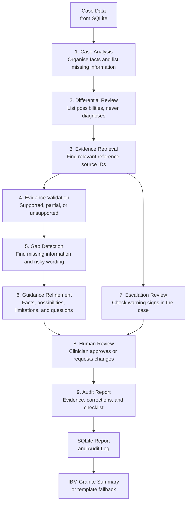

# ClinGuide AI

> **Educational use only. All cases and clinical data are entirely fictional.**
> This tool does not provide medical advice. Final decisions belong to the clinician.

ClinGuide AI is a beginner-friendly educational web application that reviews AI-generated
differential diagnosis guides for fictional clinical cases. Nine independent agents inspect
each guide for overconfident language, missing information, and safety warnings, then
present a structured revised guide for clinician sign-off.

---

## Quick Start (non-technical students)

### 1. Prerequisites
- Python 3.10 or newer ([python.org](https://www.python.org/downloads/))
- A terminal (PowerShell on Windows, Terminal on macOS/Linux)

### 2. Create a virtual environment

```bash
# Windows PowerShell
python -m venv .venv
.venv\Scripts\Activate.ps1

# macOS / Linux
python3 -m venv .venv
source .venv/bin/activate
```

### 3. Install dependencies

```bash
pip install -r requirements.txt
```

### 4. Run the application

```bash
uvicorn app.main:app --reload
```

Then open **http://127.0.0.1:8000** in your browser.

### 5. Run the tests

```bash
pytest tests/ -v
```

---

## Optional: IBM Granite AI Summaries

ClinGuide AI can call IBM Granite (via [watsonx.ai](https://www.ibm.com/watsonx)) to
generate plain-English summaries of each analysis. Without these credentials the app
runs normally and shows a template summary instead.

Set these environment variables **before** starting the server:

```bash
# Windows PowerShell
$env:WATSONX_API_KEY    = "your-api-key"
$env:WATSONX_PROJECT_ID = "your-project-id"
# Optional – defaults to us-south
$env:WATSONX_URL        = "https://us-south.ml.cloud.ibm.com"

# macOS / Linux
export WATSONX_API_KEY="your-api-key"
export WATSONX_PROJECT_ID="your-project-id"
```

---

## Project Structure

```
clinguide-ai/
├── app/
│   ├── __init__.py     # Package marker
│   ├── main.py         # FastAPI app, routes, CORS, static serving
│   ├── db.py           # SQLite helpers, table creation, seed data
│   ├── agents.py       # Nine agent functions + run_pipeline()
│   ├── rag.py          # Word-overlap retrieval (no ML libraries)
│   └── granite.py      # IBM Granite / watsonx.ai integration
├── data/
│   ├── cases.json      # 3 fictional clinical cases
│   └── references.json # 12 approved reference snippets (REF-001…REF-012)
├── static/
│   ├── index.html      # Single-page frontend shell
│   ├── style.css       # Hospital dashboard styles (blue/white/teal)
│   └── app.js          # Vanilla JS, hash routing, XSS-safe DOM updates
├── tests/
│   └── test_app.py     # pytest suite (RAG, agents, pipeline, API routes)
├── requirements.txt
└── README.md
```

---

## Agent Workflow



---

## API Reference

| Method | Path | Description |
|--------|------|-------------|
| GET | `/api/cases` | List all fictional cases |
| GET | `/api/cases/{id}` | Full case data |
| POST | `/api/cases/{id}/analyze` | Run the nine-agent pipeline |
| GET | `/api/cases/{id}/report` | Most recent report |
| POST | `/api/cases/{id}/review` | Submit clinician review |
| GET | `/api/audit` | Full audit log (optional `?case_id=`) |
| GET | `/api/stats` | Dashboard statistics |

---

## Responsible AI

ClinGuide AI was designed with the following Responsible AI principles:

| Principle | Implementation |
|-----------|----------------|
| **Transparency** | Every claim is traced to a source ID. The Granite source is always labelled ("granite" or "template"). |
| **Uncertainty** | The app never states a confirmed diagnosis. Overconfident language is flagged and soft-redacted. |
| **Human oversight** | A clinician must review and sign off every report before it is considered complete. |
| **Explainability** | The evidence table, gap detection, and audit report show exactly why each claim was flagged. |
| **Non-maleficence** | Warning-sign references trigger explicit escalation alerts. Missing investigations are listed. |
| **Fictional data only** | No real patient data is ever used. An "Educational use only" banner is shown on every page. |
| **Auditability** | Every agent step and clinician decision is logged in the `audit_log` table. |

---

## Notes for Students

- The **original AI guide** in each case contains deliberate flaws (overconfident words,
  absolute exclusions, missing information) so you can see exactly what the agents detect.
- The **RAG retrieval** uses simple word overlap — no neural embeddings or API calls.
- The **database** is a plain SQLite file (`clinguide.db`) created automatically on first run.
- You can delete `clinguide.db` at any time to reset to a clean state.
